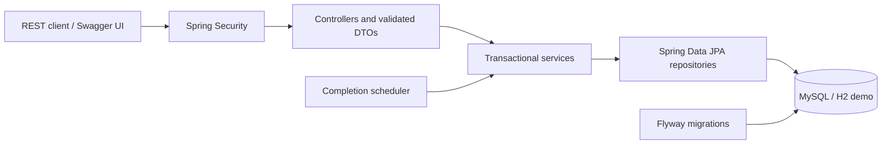
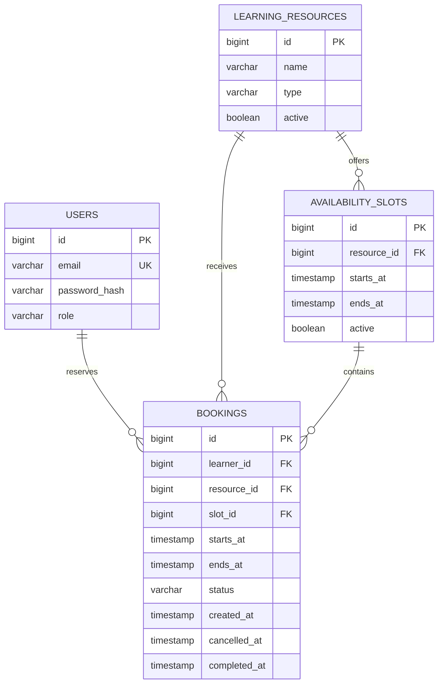

# LearnReserve

[](https://github.com/AdityaBansal0123/learnreserve/actions/workflows/ci.yml)

A Java backend for discovering learning resources, publishing availability, and making reservations that remain consistent under concurrent requests.

**Java 21 · Spring Boot 3.5 · Spring Data JPA / Hibernate · MySQL 8.4 · Flyway · Maven · OpenAPI**

The core guarantee is simple: **two confirmed reservations for the same resource cannot overlap through the API**, even when requests run on different application instances. A database row lock serializes the check-and-insert transaction for each resource.

## Run in two minutes

### Local demonstration (Java 21 only)

No database installation, Docker, paid account, or globally installed Maven is needed. The Maven wrapper downloads Maven on its first run.

```bash
./mvnw spring-boot:run -Dspring-boot.run.profiles=demo
```

Windows PowerShell:

```powershell
.\scripts\run-demo.ps1
# Or, with Java 21 on PATH:
.\mvnw.cmd spring-boot:run '-Dspring-boot.run.profiles=demo'
```

Open **http://localhost:8080/swagger-ui.html** and click **Authorize**.

| Demo role | Email | Password |
| --- | --- | --- |
| Admin | `admin@learnreserve.local` | `DemoAdmin!2026` |
| Learner | `learner@learnreserve.local` | `DemoLearner!2026` |

The demo seeds a study room, mentoring resource, and workshop with seven days of availability starting **tomorrow, 09:00–17:00 UTC**. Its H2 database is in memory and resets on restart. These public credentials are for local demonstration only. The default configuration uses MySQL and does **not** create demo accounts or sample resources.

Run the live demo smoke test from another PowerShell window:

```powershell
.\scripts\smoke-test.ps1
```

### MySQL + application with Docker Compose

```bash
cp .env.example .env
# Replace the example passwords and admin email in .env.
docker compose up --build -d
docker compose logs -f api
```

On PowerShell, use `Copy-Item .env.example .env`. The API listens on `127.0.0.1:8080`; MySQL stays on the Compose network. Data survives container restarts in the `mysql-data` volume. `docker compose down` stops the stack without deleting that volume.

### Existing MySQL, without Docker

Create a database and a dedicated user (substitute your password):

```sql
CREATE DATABASE learnreserve CHARACTER SET utf8mb4 COLLATE utf8mb4_unicode_ci;
CREATE USER 'learnreserve'@'localhost' IDENTIFIED BY 'your-database-password';
GRANT ALL PRIVILEGES ON learnreserve.* TO 'learnreserve'@'localhost';
```

Set `DB_URL`, `DB_USERNAME`, `DB_PASSWORD`, `ADMIN_EMAIL`, and `ADMIN_PASSWORD` in the process environment, then:

```bash
./mvnw clean verify
java -jar target/learnreserve-1.0.0.jar
```

The default URL is `jdbc:mysql://localhost:3306/learnreserve?connectionTimeZone=UTC&forceConnectionTimeZoneToSession=true`. Flyway applies the schema; Hibernate validates it instead of silently changing it. The configured admin is created only if its email does not exist. Environment variables do not reset an existing account's password or promote an existing learner.

## Scope and business rules

- Resources are `STUDY_ROOM`, `MENTORING`, or `WORKSHOP`.
- **Each resource is exclusively reservable.** A workshop represents an exclusive session reservation, not a multi-seat ticket system. This deliberately follows the assignment's requirement that two users cannot reserve the same resource/time.
- Admins create and update resources, activate/deactivate resources, and create/close availability windows. Windows on the same resource cannot overlap.
- Learners reserve any interval entirely contained in **one** active window. A booking is at most 24 hours; a window and an availability query are at most 31 days.
- Time intervals are **half-open `[start, end)`**. `10:00–11:00` and `11:00–12:00` are compatible; `10:30–11:30` conflicts with both.
- Timestamps require ISO-8601 offsets, use whole seconds, and are stored/returned in UTC. A timestamp with `+05:30` represents the same instant as its UTC equivalent.
- A booking must start strictly in the future. This is rechecked after acquiring the database lock.
- Cancellation is allowed only before the start. Repeated cancellation succeeds without changing the original cancellation timestamp.
- A scheduled, idempotent update marks ended confirmed bookings `COMPLETED` every 60 seconds. It catches up after downtime. Status may remain `CONFIRMED` until the next run; the timestamp rules still prevent cancellation after start.
- Deactivation stops new bookings and discovery but honors existing reservations. Close a window only when it has no upcoming/ongoing confirmed bookings. Rows with historical meaning are retained.
- Different resources can be reserved concurrently. The same learner may book different resources at overlapping times; learner calendar conflicts are outside this assignment's scope.

## Architecture



The application is organized by feature: `auth`, `resource`, `availability`, and `booking`. `common` contains the error contract, pagination, and interval rules; `config` contains security, OpenAPI, and bootstrap configuration. Controllers handle HTTP, services own business rules and transaction boundaries, and repositories own database access. JPA entities are never returned directly. `open-in-view` is disabled, so DTO mapping happens inside the service transaction. An injectable `Clock` makes time-dependent tests deterministic.

### Database relationships



Foreign keys preserve relationships; checks reject invalid intervals and statuses; email has a unique constraint. Composite indexes support resource/time conflict checks, learner history, discovery, and completion. See [the migration](src/main/resources/db/migration/V1__initial_schema.sql) for the exact schema.

### Why concurrent booking is safe

Within one `READ_COMMITTED` transaction:

1. Validate the interval and acquire `PESSIMISTIC_WRITE` on the resource (`SELECT ... FOR UPDATE`).
2. Recheck future time and resource activity.
3. Find an active window containing the complete interval.
4. Check confirmed bookings using `existing.start < requested.end AND existing.end > requested.start`.
5. Insert and flush the booking, then commit. The resource lock is held until commit or rollback.

All availability mutations, resource updates, and cancellation use the **same resource lock**. A second booking transaction waits, then observes the first committed result and returns `409 BOOKING_CONFLICT`. Locking only existing booking rows would be insufficient when no booking exists yet. A Java `synchronized` block would not protect multiple application instances. An exact `(resource_id, starts_at)` unique index would not reject partial overlaps.

`READ_COMMITTED` is explicit so a transaction waiting on the lock reads newly committed reservations, rather than an earlier repeatable-read snapshot. Cancellation first reads a scalar resource ID, then takes the lock before loading the booking entity to avoid stale persistence-context state.

The guarantee applies to writes through these transactional services. MySQL has no native arbitrary-interval exclusion constraint; direct out-of-band SQL writes must not bypass the application. Per-resource locking trades some same-resource throughput for clear, testable correctness. See [design decisions](docs/decisions.md).

## REST API

All endpoints are under `/api/v1`. Public discovery needs no authentication. Other calls use HTTP Basic with a registered email/password. Use HTTPS when exposed beyond localhost.

| Method | Endpoint | Access | Purpose |
| --- | --- | --- | --- |
| POST | `/auth/register` | Public | Create learner account |
| GET | `/auth/me` | Authenticated | Current account |
| GET | `/resources?q=&type=&page=0&size=20` | Public | Search active resources |
| GET | `/resources/{id}` | Public | Resource details |
| POST | `/resources` | Admin | Create resource |
| PUT | `/resources/{id}` | Admin | Replace metadata |
| PATCH | `/resources/{id}/active` | Admin | Activate/deactivate |
| GET | `/resources/{id}/availability?from=...&to=...` | Public | Remaining free intervals |
| POST | `/resources/{id}/availability` | Admin | Publish window |
| POST | `/resources/{id}/availability/{slotId}/close` | Admin | Close window |
| POST | `/bookings` | Learner | Reserve interval |
| GET | `/bookings?status=&page=0&size=20` | Learner | Own history |
| GET | `/bookings/{id}` | Learner | Own booking |
| POST | `/bookings/{id}/cancel` | Learner | Cancel reservation |

Paged endpoints use zero-based pages and `size` 1–100. Resource order is ascending ID; history order is newest creation then ID. Availability returns published windows and their remaining free intervals; a fully occupied window has `freeIntervals: []`. This is a snapshot, not a hold: booking always validates again under the lock.

Documentation:

- Interactive Swagger: `/swagger-ui.html`
- Generated OpenAPI JSON: `/v3/api-docs`
- Generated OpenAPI YAML: `/v3/api-docs.yaml`
- Exported OpenAPI snapshot: [docs/openapi.yaml](docs/openapi.yaml) (import into Postman or Swagger Editor)
- Health: `/actuator/health`
- Walkthrough: [docs/demo.md](docs/demo.md)
- Example HTTP requests: [docs/requests.http](docs/requests.http)

### Example booking

Choose future timestamps within a published window. Replace the example resource ID and dates as needed.

```bash
curl -i -u 'learner@learnreserve.local:DemoLearner!2026' \
  -H 'Content-Type: application/json' \
  -d '{"resourceId":1,"startsAt":"2030-01-02T10:00:00Z","endsAt":"2030-01-02T11:00:00Z"}' \
  http://localhost:8080/api/v1/bookings
```

```json
{
  "id": 1,
  "resourceId": 1,
  "resourceName": "Quiet Study Room",
  "slotId": 1,
  "startsAt": "2030-01-02T10:00:00Z",
  "endsAt": "2030-01-02T11:00:00Z",
  "status": "CONFIRMED",
  "createdAt": "2030-01-01T08:00:00Z",
  "cancelledAt": null,
  "completedAt": null
}
```

Cancellation and window closure require `Content-Type: application/json`; send `{}`. Public registration cannot assign roles. Booking ownership comes from the authenticated principal, never a client-provided learner ID. A booking owned by someone else returns `404`, preventing enumeration of other learners' data.

### Consistent errors

Errors use `application/problem+json` with stable `code` values:

```json
{
  "type": "urn:learnreserve:error:booking-conflict",
  "title": "Conflict",
  "status": 409,
  "detail": "This resource is already booked during the requested interval",
  "instance": "/api/v1/bookings",
  "code": "BOOKING_CONFLICT"
}
```

| Status | Typical codes |
| --- | --- |
| 400 | `VALIDATION_FAILED`, `INVALID_REQUEST` |
| 401 | `UNAUTHORIZED` |
| 403 | `FORBIDDEN` |
| 404 | `NOT_FOUND` |
| 409 | `BOOKING_CONFLICT`, `AVAILABILITY_CONFLICT`, `OUTSIDE_AVAILABILITY`, `RESOURCE_INACTIVE`, `AVAILABILITY_IN_USE`, `CANCELLATION_CLOSED`, `EMAIL_EXISTS`, `DATA_CONFLICT`, `RESOURCE_BUSY` |
| 500 | `INTERNAL_ERROR` |

Validation errors add an `errors` array with field names/messages, never rejected values or passwords. Unexpected errors are logged server-side without returning stack traces.

## Testing

```bash
./mvnw clean verify
```

The default suite uses H2 in MySQL compatibility mode. It includes pure interval unit tests and full Spring/MockMvc tests with actual database commits, authentication, validation, lifecycle operations, and coordinated concurrency races. The booking race launches eight requests together and asserts **one 201, seven 409s, and exactly one persisted booking**. Availability races are also exercised.

For MySQL, create a **dedicated disposable test database** called `learnreserve_test` and user `learnreserve` with password `test-password`, or configure the variables below. Tests intentionally clear application tables between cases; never point them at real data.

```bash
./mvnw clean verify -Dspring.profiles.active=test,mysql-test
```

PowerShell:

```powershell
.\mvnw.cmd clean verify '-Dspring.profiles.active=test,mysql-test'
```

Optional test variables: `MYSQL_TEST_URL`, `MYSQL_TEST_USERNAME`, `MYSQL_TEST_PASSWORD`. The same assertions run against both engines. GitHub Actions has separate H2 and MySQL service jobs; neither silently skips tests if MySQL is unavailable.

Reports after verification:

- Test results: `target/surefire-reports/`
- JaCoCo coverage: `target/site/jacoco/index.html`
- Runnable application: `target/learnreserve-1.0.0.jar`

See [verification results](docs/verification.md) for the checks run when preparing this submission.

## Configuration and deployment

| Variable | Meaning |
| --- | --- |
| `DB_URL` | MySQL JDBC URL; use UTC connection/session options |
| `DB_USERNAME`, `DB_PASSWORD` | Database credentials |
| `ADMIN_EMAIL`, `ADMIN_PASSWORD` | Initial admin; password at least 12 characters, at most 72 UTF-8 bytes |
| `PORT` | HTTP port, defaults to 8080 |
| `SPRING_PROFILES_ACTIVE=demo` | Disposable local demo, with public demo credentials |

The Docker image uses a multi-stage build and a non-root runtime user. Health checks, graceful shutdown, and environment configuration are included. The Compose setup provides a reproducible local deployment, which satisfies the assignment's local demonstration option. It needs no paid service. Hosting can use any Java 21/container platform with a reachable persistent MySQL database; configure HTTPS and secrets there. Do not deploy the demo profile as a persistent service.

Security deliberately uses Spring Security's standard HTTP Basic for this bounded backend assignment instead of a custom JWT implementation. Passwords use BCrypt with cost 12 and an explicit UTF-8 byte limit. The API is stateless; form login, request caching, and sessions are disabled. JSON-only state-changing endpoints and no cross-origin CORS policy prevent ordinary cross-origin form writes. A browser-cookie login would require revisiting CSRF protection. See [design decisions](docs/decisions.md) for limitations and sensible next steps.

## Submission

1. Run both test configurations and the live smoke test.
2. Create a GitHub repository, commit this project, and push it. Do not commit `.env`, `target`, or local database files.
3. Check the Actions results, then submit the repository URL with the local run command and Swagger URL.
4. Use the [five-minute demo](docs/demo.md) and [interview preparation notes](docs/interview-notes.md) to explain the locking strategy, tradeoffs, and tests.

Framework references: [Spring Boot requirements](https://docs.spring.io/spring-boot/3.5/system-requirements.html), [Spring Data JPA locking](https://docs.spring.io/spring-data/jpa/reference/jpa/locking.html), [springdoc OpenAPI](https://springdoc.org/v2/).
